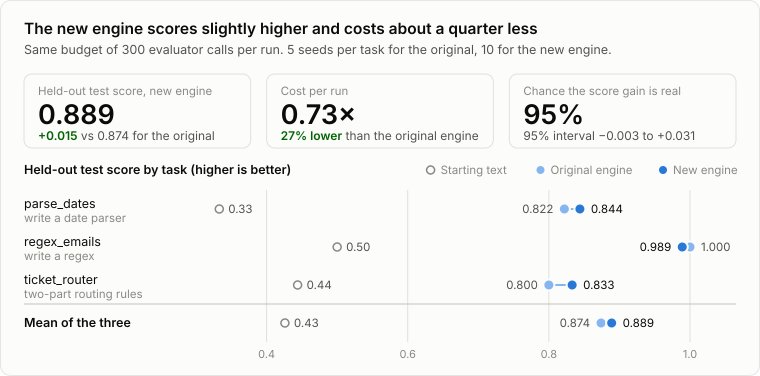
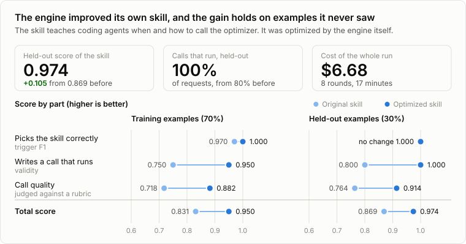

# optimize-anything

Give it a piece of text (a prompt, a regex, a config, agent instructions, a small program), plus a way to score that text. It keeps proposing better versions until it runs out of budget.

Each round, an LLM reads why the current version lost points (failing cases, errors, judge comments), proposes a fix, and keeps it only if it scores better. The method is inspired by [GEPA](https://arxiv.org/abs/2507.19457).

<p align="center"><picture>
  <source media="(prefers-color-scheme: dark)" srcset="docs/figures/loop-dark.svg">
  
</picture></p>

*One round, start to finish. The card is your text. It is picked from the pool (1), scored on a few examples (2), rewritten by an LLM that reads what failed (3), scored again (2), and kept only if it beats the old best (4). The engine repeats this until the budget runs out.*

**You need:** macOS or Linux, Node 18+, [uv](https://docs.astral.sh/uv/), and either a Claude/ChatGPT subscription logged in to `claude` / `codex`, or an `ANTHROPIC_API_KEY` / `OPENAI_API_KEY`.

## Install (one command)

```bash
git clone https://github.com/rachittshah/optimize-anything && cd optimize-anything
scripts/install.sh            # builds everything, registers it with every coding agent it finds
scripts/install.sh --doctor   # checks each agent: config, server, a free test run, skill
```

The installer covers Claude Code, Codex CLI, OpenCode and Gemini CLI. For each agent it registers the `optimize-anything` tool server (MCP) and installs the skill that teaches the agent when and how to use it. See [what the installer changes](#what-the-installer-changes) for the exact edits it makes to your config files.

## Use it from your coding agent

Ask in plain words. The skill loads when the request fits:

- "Optimize this system prompt so it classifies these 20 tickets correctly. Keep 6 aside to check it generalizes."
- "Make this regex pass all the cases in `cases.json`."
- "Tune `retry_policy.yaml` until `./bench.sh` reports p99 under 200 ms."
- "Improve my judge rubric so it agrees with these hand labels."

The agent writes the optimization call: the text to improve, how to score it, the goal, and a budget. It starts the run in the background and checks back. When the run finishes, it shows you the diff, the score gain, the score on held-out examples and the cost, and applies the change only if you agree.

The skill doesn't load for one-off edits ("make this paragraph better"), for writing tests, for numeric hyperparameter tuning, or for questions about how the method works.

## Use it from Python or the command line

```python
from optimize_anything import optimize_anything, Config

def evaluate(candidate, example):
    got = classify(candidate, example["input"])          # run your prompt / code
    ok = got == example["expected"]
    return (1.0 if ok else 0.0), {"input": example["input"], "expected": example["expected"], "got": got}

result = optimize_anything(
    seed_candidate={"system_prompt": open("prompt.txt").read()},
    evaluator=evaluate,
    dataset=train, valset=val, testset=test,   # val picks the winner; test is only reported
    objective="Classify tickets exactly; never invent a new label",
    config=Config(max_metric_calls=200, max_cost_usd=5),
)
print(result.best_score, result.best_test, result.total_cost_usd)
print(result.best_candidate["system_prompt"])
```

```bash
cd engine
uv run optimize-anything run --config job.json --dry-run   # score the starting text only; catches evaluator bugs
uv run optimize-anything run --config job.json --events    # full run, streams progress as JSON lines
```

`job.json` holds the same fields as the Python call.

## How it works

1. Score the starting text on a few training examples.
2. Show the LLM the text plus the diagnostics for those examples: what failed and why.
3. The LLM proposes a new version. If it scores better on the same examples, the new version is scored on the validation set.
4. The engine keeps a pool of versions that are each best on at least one example (a Pareto frontier), and picks the next one to improve from that pool. This keeps good partial solutions alive instead of chasing one average score.
5. Stop at the budget, the cost cap, a plateau, or when every training example is solved. In that last case, add harder examples.

The returned winner must beat the previous best by more than the noise on the validation set (a paired standard-error test). This stops lucky scores from being reported as wins. Test-set scores are never used to pick anything.

## Picking an evaluator

Your evaluator returns `(score between 0 and 1, dict of diagnostics)`. The diagnostics matter most, because the LLM reads them to decide what to fix.

| You have | Use | Example |
|---|---|---|
| Labels, expected outputs, tests, a checkable property | `python` | compare output to expected; return the failing cases |
| An existing benchmark or test command | `shell` | `python3 bench.py --candidate {{candidate_file}} --example {{example_file}}` |
| Only a subjective goal (tone, readability) | `llm_judge` | criteria with score anchors, ending `SCORE: X/10`, or a 0–2 `rubric` |

Prefer a checkable signal over a judge whenever you have one. Shell commands must read the candidate from `{{candidate_file}}`; pasting `{{candidate}}` into a command is unsafe. A judge that errors out or returns no score is recorded as a failed evaluation, never as a 0.

## Models and cost

Pick how the engine reaches models with `Config(backend=...)`, the `--backend` flag, or the `OA_BACKEND` env var:

| Backend | Uses | Notes |
|---|---|---|
| `auto` (default) | first available below | key → key → subscription → subscription |
| `anthropic` | `ANTHROPIC_API_KEY` | official SDK |
| `openai` | `OPENAI_API_KEY` | also OpenRouter via `openai_base_url` |
| `claude-cli` | your Claude subscription | isolated `claude -p`: none of your settings, hooks, tools or CLAUDE.md leak in |
| `codex-cli` | your ChatGPT/Codex login | each call carries ~21k extra tokens, so pair it with a cheap model |
| `mock` | nothing | free and deterministic; for tests and `--doctor` |

| Preset | Writes improvements | Judges |
|---|---|---|
| `default` | Claude Opus 5.5 | Claude Sonnet 5.5 |
| `cheap` | Claude Sonnet 5.5 | Claude Haiku 5.5 |
| `quality` | Claude Fable 5.2 | Claude Sonnet 5.5 |

Every run records spend per role, priced as if billed through the API: in `result.json`, in events, and in `result.total_cost_usd` / `result.cost_per_point`. Set `max_cost_usd` to cap it. All model IDs and prices live in one file: `engine/src/optimize_anything/llm/models.py`.

## Settings that matter

| Setting | Default | What it does |
|---|---|---|
| `max_metric_calls` / `max_cost_usd` | none | budget in evaluator calls / dollars; set at least one |
| `testset` | none | scored once at the end; reported, never used for selection |
| `promotion` | `paired_se` | the winner must beat the incumbent by more than the noise (`max` = old behaviour) |
| `prescreen` | `True` | skips evaluating proposals identical to an existing version |
| `cache_evals` | `True` | never re-scores the same text on the same example; set `False` if your evaluator is random |
| `eval_workers` | `1` | evaluate examples in parallel threads; useful when each evaluation is slow |
| `no_improvement_patience` + `min_improvement` | off | stop after N rounds without a real gain |
| `seed` | 42 | randomness for sampling and selection |

Experimental options, off by default because they didn't help on our benchmark: `val_eval="halving"`, `counterexample_mining`, `operator_bandit`, `mutation_operator="section_edit"`, `proposal_memory`, `max_edit_ratio`. [RESULTS.md](RESULTS.md) has the numbers.

## Results

<p align="center"><picture>
  <source media="(prefers-color-scheme: dark)" srcset="docs/figures/results-engine-dark.svg">
  
</picture></p>

<p align="center"><picture>
  <source media="(prefers-color-scheme: dark)" srcset="docs/figures/results-skill-dark.svg">
  
</picture></p>

[RESULTS.md](RESULTS.md) has the before/after numbers for the engine (a 3-task benchmark) and for the skill (it was optimized with this engine), the cost, and every upgrade we tried and rejected. The research behind the upgrades is in [docs/research/sota-2026.md](docs/research/sota-2026.md).

## What the installer changes

`scripts/install.sh` has these modes:
- `--dry-run` shows the plan.
- `--uninstall` removes only its own entries.
- `--agents claude,codex` limits which agents it touches.
- `--doctor --live claude` also has the agent itself call the tool once, which spends a few tokens.

| Agent | Server entry | Skill file |
|---|---|---|
| Claude Code | `claude mcp add-json -s user optimize-anything …` | `~/.claude/skills/optimize-anything/SKILL.md` |
| Codex CLI | `[mcp_servers.optimize-anything]` in `~/.codex/config.toml` | `~/.agents/skills/optimize-anything/SKILL.md` |
| OpenCode | `mcp.servers.optimize-anything` in `~/.config/opencode/opencode.json` | `~/.agents/skills/…` (shared) |
| Gemini CLI | `mcpServers.optimize-anything` in `~/.gemini/settings.json` | `~/.agents/skills/…` (shared) |

How the installer keeps your configs safe:
- **Backups:** every file is backed up to `~/.optimize-anything/backups/<timestamp>/` before writing.
- **Verification:** after each write the file is re-parsed, and the backup is restored if anything besides our entry changed.
- **No secrets:** API keys are never written. Configs reference key names only.
- **Codex approval:** the Codex entry sets `default_tools_approval_mode = "approve"` for this server's 5 tools only. Without it, `codex exec` refuses to call them.
- **Gemini trust:** not set, so Gemini still asks before each tool call when you use it interactively.
- **Re-running:** it's safe to re-run. It updates its own skill copy, and keeps anyone else's file as `SKILL.md.bak.<timestamp>`.
- **Node path:** entries pin the absolute `node` path, so re-run the installer after switching Node versions; doctor flags this.

The tool server has five tools:
- `optimize_anything`: starts a run.
- `check_optimization`: reports progress. Pass `wait_seconds` (up to 50) to wait for news.
- `get_best_candidate`
- `stop_optimization`
- `list_optimization_runs`

How runs behave:
- **Detached:** runs keep going if the agent or server exits.
- **Honest status:** a crashed run shows as `failed`, never as `completed`.
- **Input checks:** the server checks the evaluator and requires a budget. It defaults to 150 evaluator calls and $5, and says so.
- **Dry runs:** `dry_run: true` scores only the starting text.

## Project layout

```
engine/       Python engine (uv): optimization loop, evaluators, LLM backends, cost tracking
  src/optimize_anything/{core,evaluators,proposer,strategies,llm}/
  tests/      ~225 tests; no test ever calls a real LLM
mcp-server/   TypeScript MCP server (runs the engine as a detached subprocess); npm test
skill/        SKILL.md — agent-neutral skill, hill-climbed with this engine
scripts/      install.sh + doctor.py, bench/ (engine benchmark), optimize_skill.py + skill_eval/ (skill benchmark)
docs/         research survey, design doc
```

## Development

```bash
cd engine && uv sync --extra dev && uv run pytest -q     # engine tests
cd mcp-server && npm install && npm run build && npm test
scripts/bench/run_matrix.sh <name> [--config-json '{...}']   # benchmark a config (see scripts/bench/README.md)
cd engine && uv run python ../scripts/optimize_skill.py score --skill ../skill/SKILL.md   # score the skill
```
