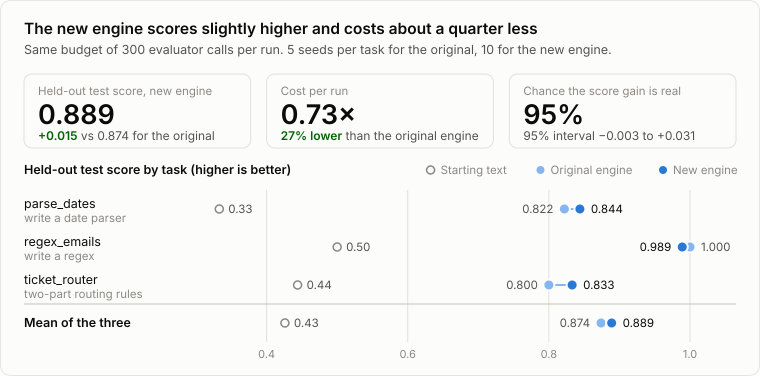
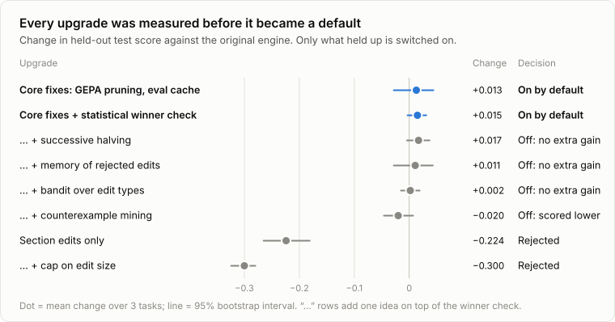
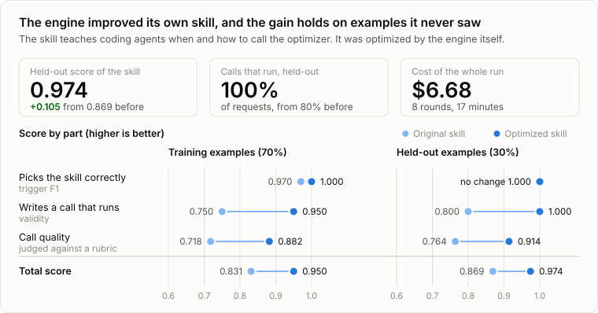

# Results: the SOTA upgrade (Nov 2026)

**Short version**
- The engine runs again on current models and on Claude/ChatGPT subscriptions.
- On our benchmark it finds slightly better solutions than before (+0.015 on held-out test), at about 27% lower cost.
- The skill that teaches agents to use it was optimized with the engine itself: validation score **0.869 → 0.974**.
- One command installs it in Claude Code, Codex, OpenCode and Gemini, and a doctor check passes for all four.
- Total model spend was about **$15** (API-equivalent) of the $100 allowed.

## 1. What changed and why it matters

**Fixes.** The original code was broken in ways the benchmark alone wouldn't show:

| Problem in the original | Effect | Now |
|---|---|---|
| Sent `temperature=1.0` and old model IDs | Every request fails on current Claude models | Model IDs live in one file; effort replaces temperature |
| Anthropic API key required | Unusable for people on a subscription | Backends for the Anthropic API, OpenAI API/OpenRouter, the `claude -p` and `codex exec` subscriptions, and a free mock |
| Checkpoint written to a nested folder, and never for short runs | The MCP server could never find a run's results | Fixed; written after every accepted candidate and at the end |
| Multi-part artifacts scored one part in the quick check but all parts in the full check | Wasted evaluations on multi-part artifacts | One rule for both checks (+0.072 test on the multi-part benchmark task) |
| A failing LLM judge was scored 0 | Optimizer punished good candidates for API hiccups | Retries; failures are recorded as failures and excluded |
| Judge prompt open to injection; first `SCORE:` parsed; no clamp | Candidates could game the judge | Candidate fenced as data; last score parsed and clamped; optional 0–2 rubric |
| Run status said "completed" for crashed runs | Agents trusted dead runs | Status read from files on disk; crashes show as `failed` |

**New:**
- **Cost:** dollar cost per run and per point gained, plus a dollar cap.
- **Held-out test set:** reported, never used for selection.
- **Stable winners:** a challenger only replaces the incumbent if it beats the noise.
- **Faithful GEPA selection:** dominated candidates are pruned exactly as GEPA does.
- **Eval cache:** no evaluation is repeated.
- **Saturation handling:** the engine notices when the training set is fully solved, instead of spinning.
- **Dry run:** scores the starting text only, to catch evaluator bugs before spending budget.
- **Long-poll status:** `check_optimization` can wait up to 50 s for news.
- **Cross-agent install:** an installer with a doctor check.

## 2. Engine: before and after

<picture>
  <source media="(prefers-color-scheme: dark)" srcset="docs/figures/results-engine-dark.svg">
  
</picture>

**Benchmark.** Three tasks, each with train/validation/test splits; test is never shown to the optimizer:
- `regex_emails`: write a regex.
- `parse_dates`: write a date parser.
- `ticket_router`: write two-part routing rules.

Each configuration ran 5 seeds per task. Every run had the same budget of 300 evaluator calls and used `claude-haiku-5-5` as the proposer. The score is the held-out test score of the returned winner.

| | parse_dates | regex_emails | ticket_router | Mean | Cost |
|---|---|---|---|---|---|
| Starting text | 0.333 | 0.500 | 0.444 | 0.426 | |
| Original engine | 0.822 | 1.000 | 0.800 | 0.874 | 1.00x |
| **New engine (defaults, 10 seeds)** | 0.844 | 0.989 | 0.833 | **0.889** | **0.73x** |

- **The gain is small.** +0.015 test on average, 95% interval [−0.003, +0.031], so a 95% chance it's real (stratified bootstrap).
- **It uses fewer evaluations.** On the two tasks where the training set gets fully solved, the new engine stops early and uses about a third of the evaluations.
- **Variance is lower.** Paired promotion cut the train/val gap on `regex_emails` from 0.014 to −0.001.
- **How we got the 10 seeds:** the new-engine row pools round 1 and an independent replicate. The replicate alone was +0.009, round 1 alone +0.020 [+0.002, +0.037].

Reproduce with `scripts/bench/ab_rounds.sh 1` and `scripts/bench/ab_rounds.sh 2`, then summarize with `python3 scripts/bench/summarize.py --baseline main <files>`. Raw runs are in `scripts/bench/results/`.

## 3. Upgrades tried: adopted and rejected

<picture>
  <source media="(prefers-color-scheme: dark)" srcset="docs/figures/results-upgrades-dark.svg">
  
</picture>

Each idea came from the research grid (`docs/research/sota-2026.md`: 7 independent expert reviews, 20 design axes, 61 candidates). Each one was built behind a flag and measured against the original engine (Δ = change in mean test score):

| Idea (source) | Δ test vs original | 95% interval | Cost | Decision |
|---|---|---|---|---|
| GEPA-faithful core: same-text scoring, GEPA pruning, eval cache, failed ≠ 0 | +0.013 | [−0.028, +0.044] | 0.79x | **Adopted.** Correctness fixes, and cheaper |
| + paired promotion (RLMOpt, eval lead) | +0.015 (pooled) | [−0.003, +0.031] | 0.73x | **Adopted as default** |
| + skip exact-duplicate proposals | n/a (it can't change which candidate is accepted) | | saves evals | **Adopted as default** |
| Successive halving on validation (TRIPLE, RL expert) | +0.017 with promotion | [−0.004, +0.037] | 0.75x | Not adopted: no gain beyond promotion alone (−0.004 vs promotion) |
| Counterexample mining (CEGIS, program synthesis) | −0.020 with promotion | [−0.046, +0.007] | 0.74x | Rejected: worse than promotion alone (−0.041) |
| Operator bandit: rewrite / section edit / compress (OpenTuner) | +0.002 with promotion | [−0.015, +0.019] | 0.59x | Rejected for score. Cheaper, but −0.019 vs promotion alone |
| Rejected-edit memory (SkillOpt, GEPA PR) | +0.011 with promotion | [−0.028, +0.043] | 0.67x | Off by default; no measurable gain. Used in the skill run |
| Section edits only (SEPO) | **−0.224** | [−0.265, −0.181] | 0.58x | Rejected. With a small proposer, minimal edits rarely fix the hidden rules |
| Edit-size cap (SkillOpt "learning rate") | **−0.300** | [−0.324, −0.280] | 9x | Rejected. On small artifacts every real fix exceeds the cap, so the run spins with no progress. 4 runs stopped by hand after 40 min |
| Duplicate prescreen, round-1 run (ShinkaEvolve) | +0.002 | [−0.035, +0.033] | 0.74x | Kept in exact-duplicate form only. The run didn't record whether the 0.98 similarity filter was on. That filter blocks 1–2 character fixes, so it stays off by default |

Rejected on evidence, without building:
- Model-weight RL (GRPO): it needs about 24k rollouts, versus GEPA's 1.8k–7k for a higher score.
- Merge on by default: it hurt in GEPA's own ablation.
- Best-of-N proposals, quality-diversity archives, UCT, simulated annealing.

The reasons and citations are in the research doc.

## 4. Skill: before and after

<picture>
  <source media="(prefers-color-scheme: dark)" srcset="docs/figures/results-skill-dark.svg">
  
</picture>

The skill (`skill/SKILL.md`) was optimized with this engine. It was scored on four parts:

| Part | Weight | How it's scored |
|---|---|---|
| Trigger F1 | 0.3 | Does a router model pick the skill from 15 competing skill descriptions? 50 prompts, including near-misses like "optimize my SQL query". |
| Formulation validity | 0.3 | Does an agent following the skill write an optimization call that actually runs? 30 requests; runs go through the engine with a free proposer and a local API stub. |
| Formulation quality | 0.3 | A judge scores the call against a 7-point rubric and a gold answer. The judge never sees the skill. |
| Brevity | 0.1 | Penalty above 150 lines. |

70% of the items were used for training and 30% held out for validation.

| | Trigger F1 | Validity | Quality | Brevity | **Total** |
|---|---|---|---|---|---|
| Original skill, train | 0.970 | 0.750 | 0.718 | 1.0 | **0.831** |
| Original skill, val | 1.000 | 0.800 | 0.764 | 1.0 | **0.869** |
| Best found by the engine, train | 1.000 | 0.950 | 0.907 | 1.0 | 0.957 |
| Best found by the engine, val | 1.000 | 1.000 | 0.943 | 1.0 | 0.983 |
| **Shipped skill, train** (engine best + 3 lines on new features) | 1.000 | 0.950 | 0.882 | 1.0 | **0.950** |
| **Shipped skill, val** | 1.000 | 1.000 | 0.914 | 1.0 | **0.974** |

How the run went:
- **Run:** 8 iterations, then stopped at a plateau (3 iterations without a 1-point validation gain). It cost $6.68 and took 17 minutes, well under the $50 cap.
- **Proposer:** `claude-opus-5-5` through the Claude subscription.
- **Shipped version:** after the run I added three lines about new engine features (`dry_run`, `max_cost_usd`, `testset`, long-poll status). The shipped version scores 0.009 below the raw best, within noise: one validation item is worth about 3.5 points. A first run (run1) stopped after 7 minutes when the subscription's 5-hour limit hit. Its results are kept but not used.
- **What improved:** the skill now picks the evaluator from the signal available, handles string and dict candidates, and requires `{{candidate_file}}` in shell commands. It also says when to hold out validation data and when to ask instead of guessing.

**Reward-hacking check.**
- **Train prompts:** none appear in the skill (0% 5-gram overlap).
- **Gold answers:** the overlap is 21%, just above the 20% flag. All of it is generic evaluator scaffolding, such as `except Exception as e: return 0.0` and `example["input"]`, which is what the skill should teach.
- **Manual read:** I read the top 3 candidates against the rubric and found no memorized items, no judge-directed text, and no padding.
- **Held-out items:** the validation gain is on items the optimizer never saw.
- **One soft spot:** for prompt optimization the skill suggests evaluators that call an OpenAI-compatible endpoint. That's reasonable advice, but it was partly shaped by the eval set.

## 5. Cross-agent install

`scripts/install.sh` followed by `scripts/install.sh --doctor`, on this machine:

| Agent | Registered | Server starts, 5 tools | Free test run improves (0.25 → 0.75) | Skill installed | Agent calls the tool itself (`--live`) |
|---|---|---|---|---|---|
| Claude Code 2.1.322 | ✅ | ✅ | ✅ | ✅ | ✅ (8 s, $0.008) |
| Codex CLI 0.165.0 | ✅ | ✅ | ✅ | ✅ | ✅ (11 s, gpt-6-luna) |
| OpenCode 2.0.29 | ✅ | ✅ | ✅ | ✅ | ✅ (6 s, free model) |
| Gemini CLI 0.68.0 | ✅ | ✅ | ✅ | ✅ | ⚠️ Needs a one-time `gemini` login, which can't be done non-interactively |

The installer:
- backs up every file it touches
- verifies each file still parses and that nothing else in it changed
- never writes API keys
- can be re-run safely

## 6. Spend

All costs are API-equivalent, measured from the CLIs' own cost reports (Claude) or token counts × list price (Codex).

| Phase | What | $ |
|---|---|---|
| 1. Research | 7 expert agents + synthesis (agent sessions, not engine calls) | not metered by the engine |
| 2. Engine benchmark | baseline + 2 A/B rounds (about 300 runs) | 2.95 |
| 3. Skill | seed scoring, smoke test, run1 (stopped by the quota), run2, final re-score | 11.68 |
| 4. Install | live checks (Claude $0.008, Codex ≈$0.007, OpenCode $0) | 0.02 |
| **Total** | | **≈ 14.65** of the $100-per-subscription cap |

## 7. Judgement calls I made

- **Spend cap:** you said "raise sub spend for each to $100". I read that as $100 API-equivalent per subscription backend (Claude CLI, Codex CLI), with the skill cap raised from $25 to $50.
- **No API keys on this machine:** you chose subscriptions. Engine calls go through an isolated `claude -p` that loads none of your settings, hooks, MCP servers or CLAUDE.md, which was checked for leaks. `--bare` couldn't be used because it requires an API key.
- **Gemini CLI:** installed at your request, so doctor covers it.
- **Eval data:** three skill eval items (f03, f13, f25) expected a tool call but didn't include the files that call needed. I added the files before the run, because that fixes the labels, not the score.
- **Benchmark seeds:** the original engine can't take a random seed, so its runs vary only through the LLM's sampling.
- **Edit-size cap:** 4 of its 15 runs were stopped by hand after the failure mode was clear.
- **Benchmark proposer:** benchmark runs used Haiku 5.5 to keep them cheap. The research advises a strong proposer; the skill run used Opus 5.5.

## 8. Next steps

1. **Harder benchmark:** the training sets get fully solved within a few iterations, which squeezes the differences between configurations. Add larger and harder tasks plus one judge-scored task, so judge features (rubrics, a judge from another model family, pairwise comparison) can be measured.
2. **Re-check defaults with a strong proposer:** repeat the A/B with Sonnet/Opus 5.5 as proposer (`scripts/bench/ab_rounds.sh sonnet`, about $15). Do this before treating promotion and halving as settled.
3. **Make it routine:** publish the engine to PyPI and the server to npm, so installing doesn't need a clone. Add a scheduled "re-optimize and gate on held-out score" job for prompts that drift (judge rubrics, agent instructions). Log in to Gemini once so its live check passes.
